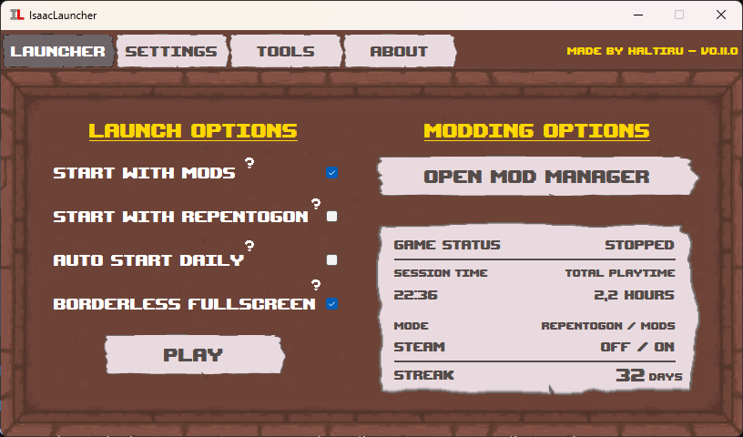
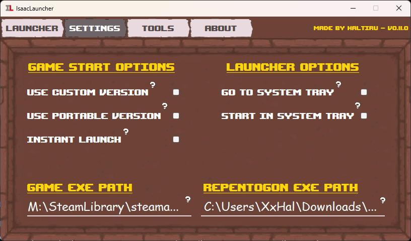
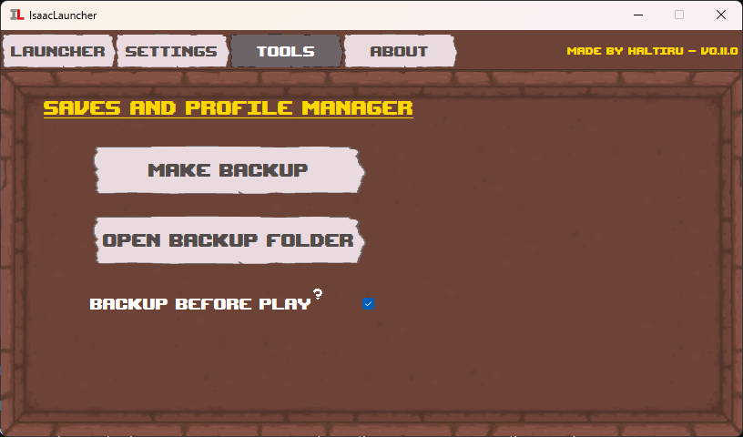
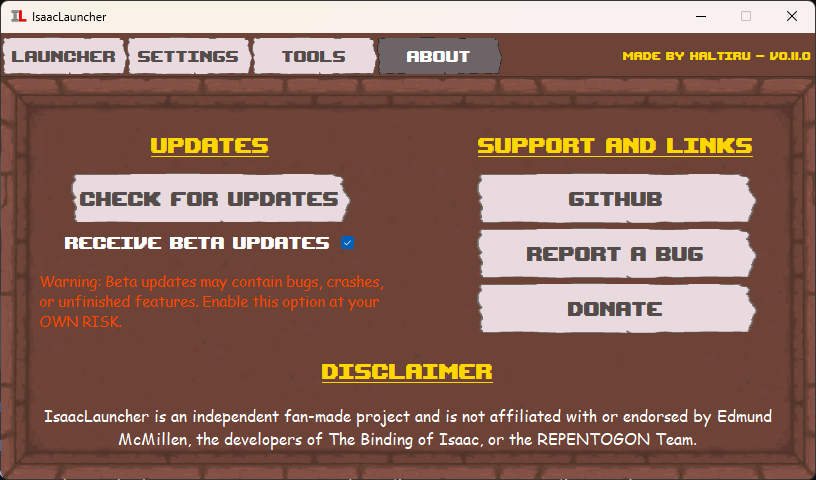
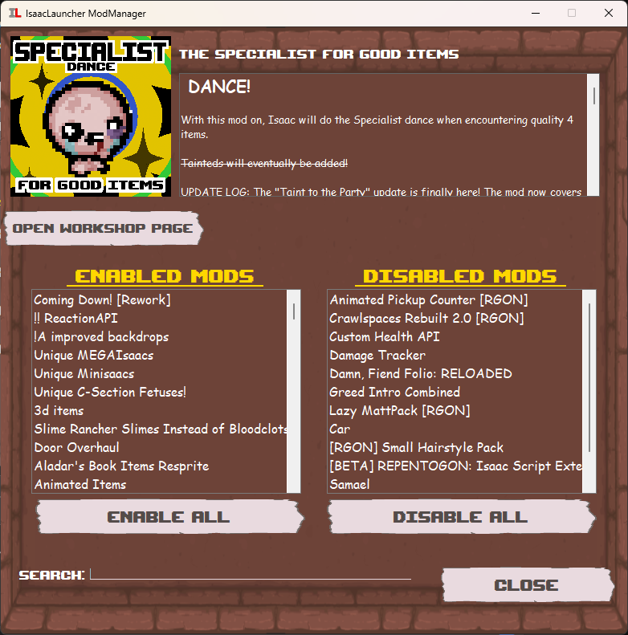

# 🎮 IsaacLauncherGUI

**A feature-rich Windows launcher for The Binding of Isaac: Repentance+.**

IsaacLauncherGUI is an unofficial, fan-made Windows application that makes it easier to launch *The Binding of Isaac: Repentance+*, manage mods, back up saves, and customize how the game starts.

**Latest stable version: `v0.11.2` — Stability & Quality Improvements**

[📥 Download Latest Stable Release](https://github.com/Haltiru/IsaacLauncher/releases/latest) · [🧪 All Releases (including Betas)](https://github.com/Haltiru/IsaacLauncher/releases) · [🐛 Report a Bug](https://github.com/Haltiru/IsaacLauncher/issues) · [💡 Suggest a Feature](https://github.com/Haltiru/IsaacLauncher/issues)

---

## What's New in v0.11.2

This maintenance release focuses on reliability, visual consistency, and cleaner internal architecture without changing existing features.

- Fixed incorrect custom fonts in update dialogs and dynamically generated popups.
- Popup backgrounds now render the launcher window directly instead of capturing the screen, preventing other applications from appearing in the background.
- Corrected popup background alignment and removed unnecessary rendering delays.
- Improved foreground activation and restoration of the launcher and Mod Manager.
- Reworked internal update management and simplified system tray, game status, and file selection logic.

See the [release notes](https://github.com/Haltiru/IsaacLauncher/releases/tag/v0.11.2) for more details.

---

## 📸 Screenshots

### 🎮 Launcher — Game Controls & Live Status

### ⚙️ Settings — Launch Preferences

### 🛠️ Tools — Save Backups

### ℹ️ About — Updates & Links

### 🧩 Mod Manager

---

## ✨ Features

### 🚀 Game Launcher & Monitoring

- **Multiple launch modes** — Steam, a custom executable, or an existing compatible portable installation.
- **REPENTOGON support** — Launch with a configured REPENTOGON executable.
- **Mod toggle** — Enable or disable mods before launching.
- **Borderless fullscreen** — Launch in a borderless window.
- **Instant Launch** — Start the game automatically when opening the launcher.
- **Smart Start** — Adjust launch options around daily challenge availability.
- **Steam readiness** — Help ensure Steam is available before Steam-mode launches.
- **Live Game Status** — See whether the game is stopped, starting, running, or stopping.
- **Session timer & total playtime** — Track the current session and accumulated launcher-tracked playtime.
- **Play/Stop controls** — Monitor and stop the running game from the launcher.

### 🧩 Mod Manager

- Browse installed mods and their descriptions.
- Search mods by name or description.
- View enabled and disabled mods separately.
- Enable or disable individual mods or multiple filtered results.
- View mod thumbnails, including downloaded thumbnails when available.
- View formatted mod descriptions with BBCode support.
- Open Steam Workshop pages when available.

### 💾 Save Management

- Back up save data for all three save slots.
- Support regular Steam and compatible portable save locations.
- Create a backup before launching the game, if enabled.
- Open the backup directory directly from the launcher.

### 📦 Existing Portable Installations

- Launch an existing compatible portable game installation.
- Support compatible portable save locations.
- **Ghost Mode** can clean up newly created Isaac folders after a supported portable session, with a confirmation warning.

> [!IMPORTANT]
> Creating new portable game copies is **not included in public releases**. IsaacLauncherGUI does **not** include or distribute game files.
>
> **Ghost Mode:** Cleanup may remove temporary `options.ini`, logs, and `save_backups` from newly created Isaac folders. Back up anything important before enabling it. Existing Isaac folders are not targeted.

### ⚙️ Convenience & Customization

- Remember settings and window position between sessions.
- Config recovery backups for damaged configuration files.
- Minimize to the system tray or start minimized.
- Custom game and REPENTOGON executable paths.
- Daily streak tracking and custom pixel-inspired UI.

### 🔄 Automatic Updates — Stable & Beta

- **Stable channel (default)** — Receive stable releases only.
- **Beta channel (opt-in)** — Receive prereleases as well as newer stable releases.
- Semantic versioning support (for example, `0.11.0-beta.1` and `0.11.0`).
- In-app **Update / Later / Skip** choices.
- Download progress, installation status, automatic relaunch, and rollback on installation errors.

> [!WARNING]
> Beta releases may contain bugs or unfinished features. Switching from Beta to Stable does not automatically downgrade an installed beta build.

---

## 📥 Installation

1. Open the [latest stable release](https://github.com/Haltiru/IsaacLauncher/releases/latest).
2. Download the release ZIP.
3. Extract **all files** to a writable folder; keep the included DLLs alongside the executable.
4. Run `IsaacLauncherGUI.exe`. The launcher may request administrator privileges at startup; declining the request allows it to continue with normal permissions, although some operations may be affected.
5. Configure your game path and preferred launch options.

To try prereleases, enable **Receive Beta Updates** on the **About** tab.

## 📋 Requirements

| Requirement | Details |
|---|---|
| Operating system | Windows |
| Framework | .NET Framework 4.8 |
| Game | The Binding of Isaac: Repentance+ |
| Steam | Required for Steam launch mode |
| REPENTOGON | Optional |
| Portable mode | Existing compatible portable installation |

---

## 🛠️ Build from Source

1. Clone the repository: `git clone https://github.com/Haltiru/IsaacLauncher.git`
2. Open `IsaacLauncherGUI.sln` in Visual Studio.
3. Restore NuGet packages.
4. Select the **Release** configuration and build.

> [!NOTE]
> Some private development-only components are excluded from the public source. Debug builds may require additional local files.

---

## 🗺️ Roadmap

### ✅ v0.9.0 — First Public Release
Core launcher, multiple launch modes, REPENTOGON integration, Mod Manager, backups, and settings.

### ✅ v0.10.0 — Updater & Stability
Improved update installation, recovery, configuration reliability, window positioning, and portable cleanup safeguards.

### ✅ v0.11.0 — Live Game Status & Beta Updates
- Live game status, session timer, and total playtime.
- Improved game startup and REPENTOGON monitoring.
- Mod Manager thumbnail and BBCode improvements.
- Stable/Beta update channels with semantic version handling.
- UI refinements, refactoring, and stability improvements.

### ✅ v0.11.2 — Stability & Quality Improvements
- Improved popup rendering and custom font consistency.
- Improved launcher and Mod Manager window activation.
- Reworked update management and simplified internal UI logic.
- Reduced duplicated code to improve maintainability.

### 🔧 Future v0.x Releases
- [ ] Bug fixes and reliability improvements
- [ ] Performance optimizations
- [ ] UI/UX polishing
- [ ] Quality-of-life features
- [ ] Investigate administrator privilege requirements and request elevation only where necessary

### 🎯 v1.0.0 — Major Milestone
- [ ] **Profile Manager** for gameplay configurations.
- [ ] Complete major bug fixes and reliability improvements.
- [ ] Optimize and polish the application and UI.
- [ ] Thoroughly test the finished release.

**No fixed release date:** v1.0.0 will ship when the launcher is ready.

---

## 🙏 Credits

The Mod Manager's design and workflow were strongly inspired by the **REPENTOGON Team**. IsaacLauncherGUI is independently developed in C#.

## 🐛 Bug Reports & Feature Requests

Please [open a GitHub issue](https://github.com/Haltiru/IsaacLauncher/issues) with the launcher version, steps to reproduce, error messages, and screenshots when relevant.

## ⚠️ Disclaimer

IsaacLauncherGUI is an independent, unofficial fan project. It is not affiliated with or endorsed by Edmund McMillen, the developers or publishers of *The Binding of Isaac*, or the REPENTOGON Team. No game files are included or distributed.

## ❤️ Support

If you find the launcher useful, consider starring the repository. Feedback and bug reports are welcome!

*Good luck on your next run — and may Dead God be with you!* 🏆
