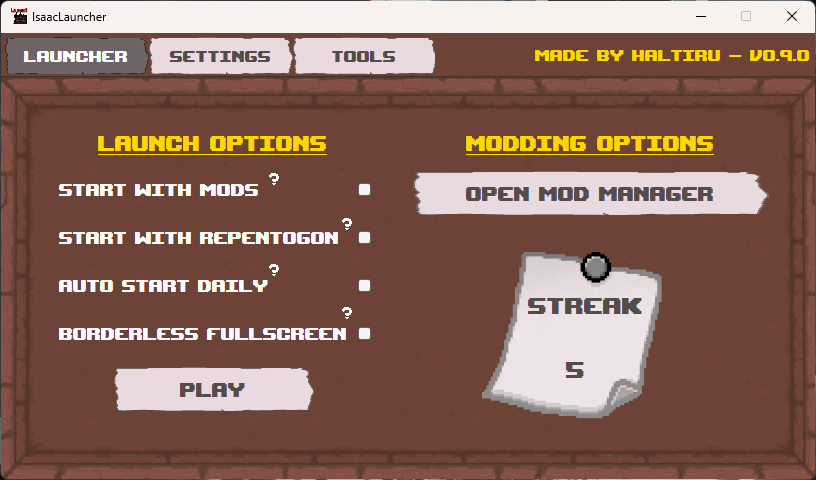
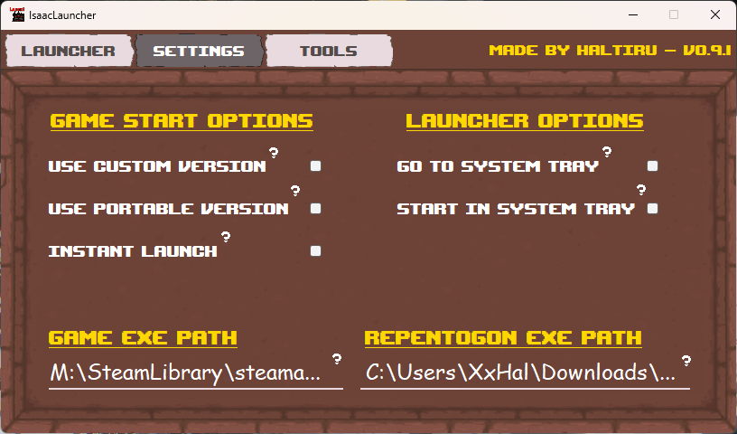
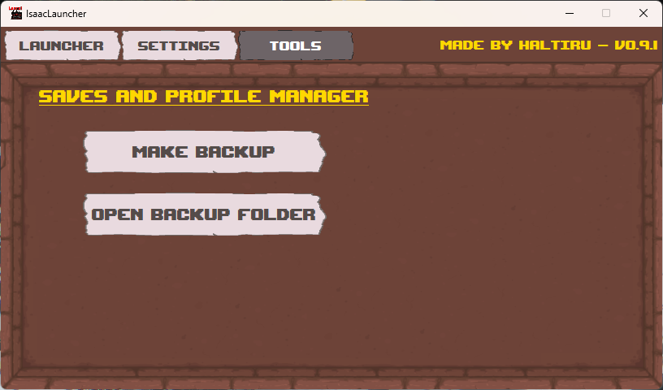
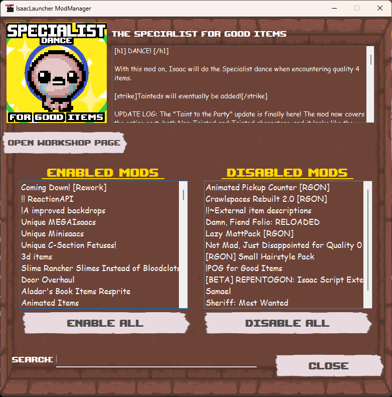

# 🎮 IsaacLauncherGUI

**A feature-rich Windows launcher for The Binding of Isaac: Repentance+.**

IsaacLauncherGUI is an unofficial launcher designed to make launching *The Binding of Isaac: Repentance+*, managing mods, handling save backups, and customizing your gameplay experience easier — all from one application.

**Current Version:** `v0.9.3`

[📥 Download Latest Release](https://github.com/Haltiru/IsaacLauncher/releases/latest) • [🐛 Report a Bug](https://github.com/Haltiru/IsaacLauncher/issues) • [💡 Suggest a Feature](https://github.com/Haltiru/IsaacLauncher/issues)

---

## 📸 Screenshots

### 🎮 Launcher

### ⚙️ Settings

### 🛠️ Tools

### 🧩 Mod Manager

---

## ✨ Features

### 🚀 Game Launcher

- **Multiple Launch Modes** — Launch through Steam, use a custom game executable, or start an existing portable game copy.
- **REPENTOGON Support** — Configure and launch the game with REPENTOGON.
- **Mod Toggle** — Enable or disable mods before launching.
- **Borderless Fullscreen** — Play in a borderless fullscreen window.
- **Instant Launch** — Automatically start the game when the launcher opens.
- **Smart Start** — Automatically adjust mod and REPENTOGON settings around the daily challenge reset.
- **Automatic Steam Startup** — Detect whether Steam is ready and attempt to start it when necessary.
- **Game Monitoring** — Detect when the game starts or stops and control it using the Play/Stop button.

### 🧩 Mod Manager

Manage your installed mods without manually editing game files.

- Browse installed mods with names and descriptions.
- Separate enabled and disabled mods into dedicated lists.
- Enable or disable individual mods.
- Enable or disable multiple mods using search filters.
- Search mods by name or description.
- Display mod thumbnails.
- Open Steam Workshop pages when available.
- Automatically download missing mod thumbnails.

### 📦 Portable Mode

IsaacLauncherGUI supports launching and managing existing portable game installations.

- Launch an existing compatible portable game copy.
- Support portable save locations.
- **Ghost Mode** — Clean up game-related folders created during portable sessions.

> [!IMPORTANT]
> Creating new portable game copies is **not available in the public release**.
>
> Portable Mode requires an existing compatible installation.
>
> IsaacLauncherGUI does not include or distribute game files.

### 💾 Save Management

- Back up save data for all three save slots.
- Support regular Steam and existing portable save locations.
- Open the backup directory directly from the application.

### ⚙️ Customization & Convenience

- Persistent launcher configuration.
- Custom game executable path.
- Custom REPENTOGON executable path.
- Minimize to the system tray instead of closing.
- Optionally start minimized to the system tray.
- Daily play streak tracking.
- Smart Start streak tracking.
- Custom-themed interface, buttons, settings, and tooltips.

### 🔄 Automatic Updates

- Automatically check GitHub Releases for new versions.
- Notify users when updates are available.
- Download and extract update packages.
- Use a dedicated updater component to replace application files.

---

## 📥 Installation

1. Visit the [Latest Release](https://github.com/Haltiru/IsaacLauncher/releases/latest) page.
2. Download the installer or available release package.
3. Run the installer, or extract the package if necessary.
4. Launch `IsaacLauncherGUI.exe`.
5. Configure your game directory and preferred launch settings.
6. Enjoy!

---

## 📋 Requirements

| Requirement | Details |
|---|---|
| Operating System | Windows |
| Framework | .NET Framework 4.8 |
| Game | The Binding of Isaac: Repentance+ |
| Steam | Required for Steam launch mode |
| REPENTOGON | Optional |
| Portable Mode | Existing compatible portable game copy |

Some features require additional files or correctly configured paths.

---

## 🛠️ Building from Source

IsaacLauncherGUI is developed in **C# using Windows Forms** and targets **.NET Framework 4.8**.

### Steps

1. Clone the repository:

   `git clone https://github.com/Haltiru/IsaacLauncher.git`

2. Open `IsaacLauncherGUI.sln` in Visual Studio.
3. Restore the required NuGet packages.
4. Select the **Release** configuration.
5. Build the solution.

> [!NOTE]
> Certain private development-only components are intentionally excluded from the public source.
>
> The public project is intended to be built in **Release** configuration. Debug builds may require additional local development files.

---

## 🗺️ Roadmap

IsaacLauncherGUI is still actively being developed and improved.

### ✅ v0.9.0 — First Public Release

The initial public version includes:

- Core game launcher
- Multiple launch modes
- REPENTOGON integration
- Mod Manager
- Save backups
- Existing portable installation support
- Custom launcher settings
- Automatic updates
- Quality-of-life features

### 🔧 Future v0.x Updates

Development will focus on:

- [ ] Bug fixes and stability improvements
- [ ] Performance optimizations
- [ ] UI/UX improvements and revamps
- [ ] Quality-of-life additions
- [ ] Improved reliability
- [ ] General polishing and testing

### 🎯 v1.0.0 — The Major Milestone

Version **1.0.0** will represent the first fully polished major release of IsaacLauncherGUI.

Planned goals:

- [ ] **Profile Manager** — Create and manage different gameplay profiles and configurations.
- [ ] Complete major bug fixes.
- [ ] Improve performance and optimization.
- [ ] Revamp and polish the user interface.
- [ ] Refine the overall user experience.
- [ ] Reach a stable and reliable release state.

> **There is no fixed release date for v1.0.0.**
>
> It will be released when the launcher is ready, stable, and sufficiently polished.

Roadmap features and priorities may change during development.

---

## 🙏 Credits

### REPENTOGON Team

The Mod Manager in IsaacLauncherGUI was strongly inspired by the REPENTOGON team's Mod Manager, particularly its design and overall workflow.

IsaacLauncherGUI is an independently developed C# project, but credit goes to the **REPENTOGON Team** for the inspiration.

---

## 🐛 Bug Reports & Feature Requests

Found a bug? Have an idea for a new feature?

Feel free to open an issue on GitHub:

**[🐛 Open an Issue](https://github.com/Haltiru/IsaacLauncher/issues)**

When reporting a bug, please include:

- Launcher version
- Description of the problem
- Steps to reproduce the issue
- Relevant error messages
- Screenshots, if applicable

Your feedback helps make IsaacLauncherGUI better!

---

## ⚠️ Disclaimer

IsaacLauncherGUI is an independent, unofficial fan-made project.

It is **not affiliated with, endorsed by, or associated with** the developers or publishers of *The Binding of Isaac*.

This repository does not include or distribute *The Binding of Isaac* game files.

Users are responsible for obtaining the game and any optional third-party components from appropriate sources.

---

## ❤️ Support the Project

If you enjoy IsaacLauncherGUI, consider leaving a ⭐ on the repository!

Suggestions, feedback, and bug reports are always appreciated.

**Made with ❤️ for The Binding of Isaac community.**

*Good luck on your next run — and may Dead God be with you!* 🏆
